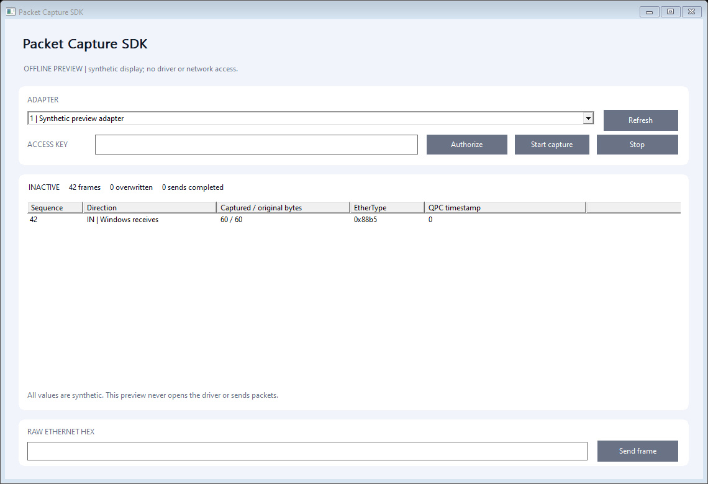

# Packet Capture SDK - Microsoft-signed Windows Kernel Ethernet I/O

**Capture Ethernet frames and send explicit raw L2 frames through a selected Windows adapter using a compact C++ API.**

A private NDIS lightweight filter supplies bounded IN/OUT records to a native application. Use it for authorized protocol laboratories, diagnostic integrations, software networking fixtures and OEM development.



**Microsoft-signed evaluation, Windows x64.** The complete 0.1.1 ZIP includes the application, CLI, C++ example, SDK, installer sources and self-contained UI/console installers with the signed 0.1.0.0 driver. Installation, live functionality and removal passed Windows 10 x64 tests with test-signing disabled, normally and under targeted Driver Verifier. See [validation and boundaries](docs/VALIDATION.md).

## What it does

| Capability | Boundary |
| --- | --- |
| Explicit selection | Enumerate up to 32 attached Ethernet filter modules; select one opaque module ID. |
| IN and OUT frames | Direction, original/captured lengths, sequence, software QPC timestamp and up to 1,518 frame bytes. |
| Bounded collection | A 256-record ring and at most 16 records per API read. Old diagnostic records are overwritten; network traffic is not queued for the application. |
| Raw L2 send | Supply 14..1,518 bytes explicitly to the selected adapter. Acceptance is asynchronous; completion counters report subsequent success/failure. |
| Owner cleanup | One administrator/SYSTEM control owner; capture stops and queued records clear when the owner closes, its permission expires, or the module pauses/detaches. |

Capture is inactive by default. Passive IN/OUT observation forwards the original packets without modification. Installing an NDIS component can temporarily pause network bindings; it does not configure routes, addresses, DNS, bridges or promiscuous mode. Only Ethernet media are supported. Wi-Fi monitor mode, raw 802.11, loopback capture, arbitrary MTUs, BPF/libpcap compatibility and production qualification are outside this edition.

Records describe the frame presented at this filter boundary, including offload effects and possible truncation. They are not guaranteed wire packets or physical timestamps. The driver bounds capture work to 64 network buffers per callback; larger chains can have unrecorded buffers. Do not infer complete traffic accounting, link throughput or zero overhead from these counters.

## Try the application

1. Download the [complete signed ZIP](https://github.com/titanfyre/Packet-Capture-SDK/releases/tag/v0.1.1), extract it and run `PacketCaptureStudio.exe --preview` for a labelled offline tour. It never opens the driver or sends a frame.
2. Request a Packet Capture SDK access key from **`titancsa` on Discord** for live capture and transmission. The UI and console installers are included in the ZIP.
3. With a supported signed release, run `PacketCaptureSetup.exe` as administrator and choose **Install / check**. Restart only when requested. Both UI and console setups share the same INetCfg installation core and require an exact Microsoft-root catalog and INF/SYS membership.
4. Open the studio as administrator, choose an exact adapter, enter the product access key and select **Authorize**, then **Start capture**. Capture never starts automatically. **Stop** clears queued records.
5. Send a frame only when its destination, payload and target adapter are part of your authorized test. Enter complete Ethernet bytes in the hex box, then select **Send frame**. There is no automatic replay or forwarding loop.

The CLI supports read-only inventory and a short explicit capture:

```powershell
PacketCaptureCLI.exe
PacketCaptureCLI.exe capture
```

Console deployment uses `PacketCaptureSetupConsole.exe /install` or `/uninstall`; code **3010** requests a manual restart. Close capture applications before maintenance. To change a driver version, uninstall the old component and then install the new signed package. Setup never restarts Windows automatically and never force-deletes an in-use package.

## Minimal C++ use

Keep all four files in `SDK/`, compile `PacketCapture.cpp` with C++17 and link `winhttp.lib` and `crypt32.lib`.

```cpp
#include "SDK/PacketCapture.h"

PacketCapture capture; // Exclusive control handle; destruction stops capture.
std::vector<PC_ADAPTER> adapters;
if (capture.Adapters(adapters)) return;
// Show adapters and ask the operator to choose one exact adapter.id.
auto error = capture.Authorize(accessKey);
if (!error.empty()) return; // English explanation, including stage/code.
if (capture.Start(selectedAdapterId)) return;

std::vector<PC_EVENT> frames;
if (!capture.Receive(frames))
    for (const auto& frame : frames) {
        // Inspect frame.direction and frame.data[0 .. frame.length).
    }
// capture.Send(ethernetBytes); // Explicit raw L2 transmission, not a capture-forward requirement.
```

`Receive()` drains up to 16 records and can return an empty vector. `Status()` reports actual capture/queue and completed-send counters; a successful `Send()` means accepted by the filter, not delivered on the network. `Adapters()` returns IDs valid for the current attached filter module lifetime; refresh after removal/restart. Serialize calls on one session. There is no automatic resend after an error.

Product-specific access keys obtain signed per-handle permissions lasting at most one hour after acceptance. Renew explicitly while the key is enabled. Disabling a key refuses future grants; existing permissions can run until expiry, including their short challenge window. Keys are not machine-bound. HTTPS and signature checks are control operations, not work repeated for each observed frame.

## Build

Visual Studio 2022 Desktop C++, CMake and a Windows SDK are required for the public app. No private kernel source or WDK is needed for that build.

```powershell
.\Build.ps1
.\Build.ps1 -Asan
# After receiving the exact signed opaque package:
.\Build.ps1 -DriverPackageDirectory C:\Signed\TitanPacketCapture
```

Outputs are in `obj/Build/bin/Release`. Ordinary source builds have no driver payload; their setup source cannot install a driver. Offline tests check parsing, frame bounds and installer identity/refusal without installing anything or opening a network adapter.

## OEM integration and responsible use

For a **paid integration pilot, OEM redistribution rights, a separately branded package or compatibility maintenance**, add **`titancsa` on Discord**. Provide target Windows builds, adapter types, data rate expectations and your intended workflow. Acceptance criteria, supported scope and redistribution terms are agreed before production delivery. See [commercial integration](docs/COMMERCIAL.md).

Npcap, Windows Packet Monitor and WinDivert already serve important capture/filtering use cases. This SDK offers a separate native integration boundary; it is not a drop-in replacement or a claim of performance or feature parity. Public app/SDK/installer source is [MIT licensed](LICENSE); driver binaries have separate evaluation/production terms. Microsoft sample references retain their [notice](docs/LICENSE-Microsoft-Samples.txt).

Use only on systems and networks you own or are authorized to administer. Captured frames may contain sensitive data; no packet content is uploaded by the application or SDK. You remain responsible for lawful deployment and handling of data and access keys. Software is supplied without warranty; applicable licenses and mandatory statutory rights govern limitations.
